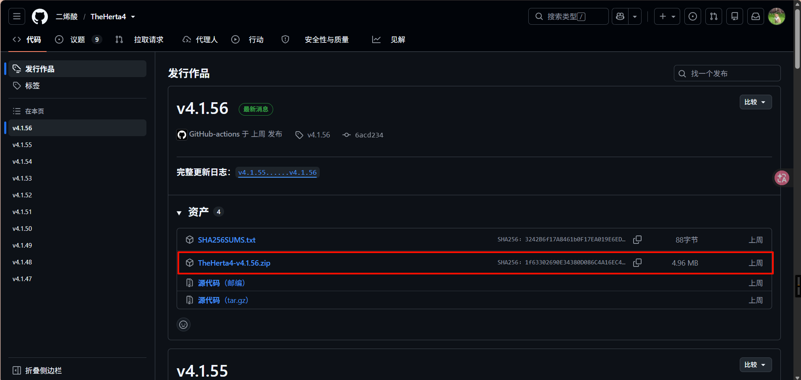
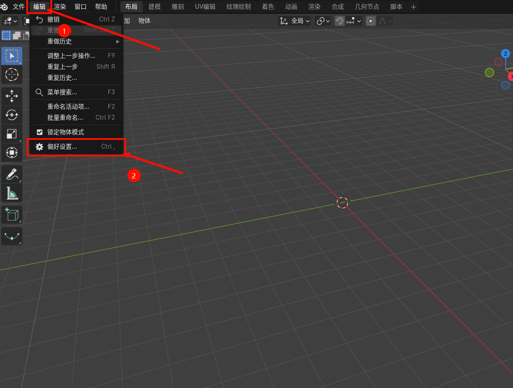
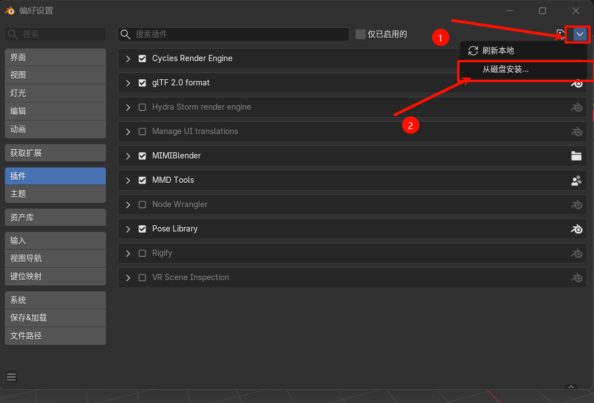
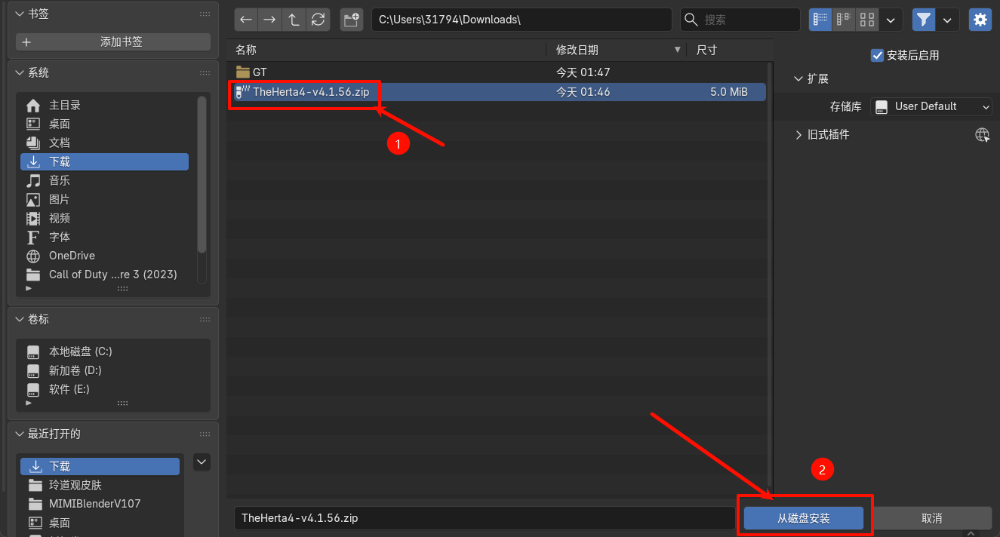
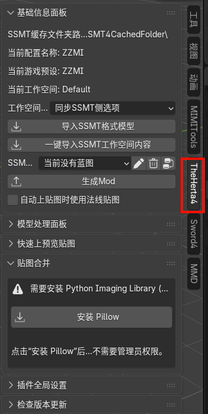
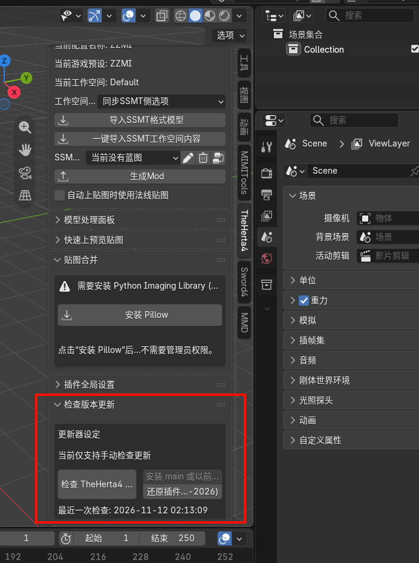
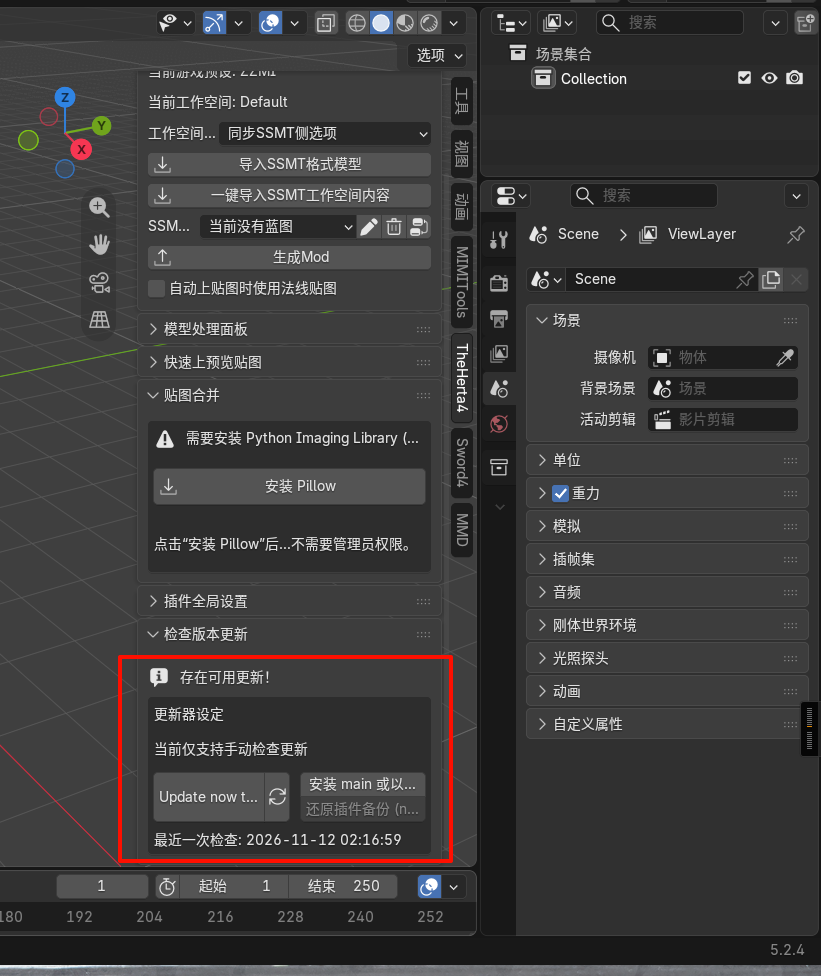
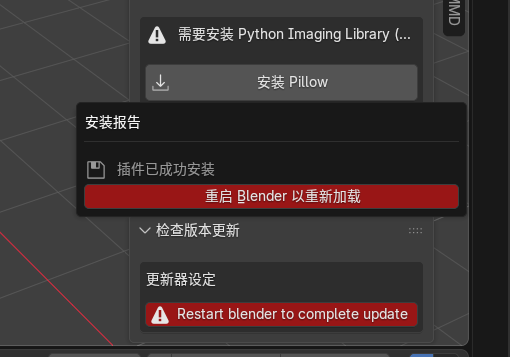

# SSMT 的 Blender 插件安装教程

## 要求

推荐使用 Blender 5.2 LTS 或更高版本。

## 下载插件

前往 [GitHub 仓库](https://github.com/Perxenic-Acid/TheHerta4)，下载 Release 中的最新插件压缩包。

下面以 Blender 5.2.4LTS为例。

## Blender 5.2.0 及以上

1. 顶部菜单选择 `编辑` > `偏好设置`。

   

2. 进入 `插件`，点击右上角箭头，选择 `从磁盘安装`。

   

3. 选择下载好的 `TheHertaVxxx.zip`，点击 `从磁盘安装`。

   

4. 关闭偏好设置。在 3D 视图中按 `N` 打开侧栏，确认出现 `TheHerta`。

   

## 更新插件

在侧栏打开 `TheHerta4` 工作菜单，点击 `检查TheHerta4更新`。

如果有更新，点击 `Update Now to (x.x.x)`。

更新完成后重启 Blender。

